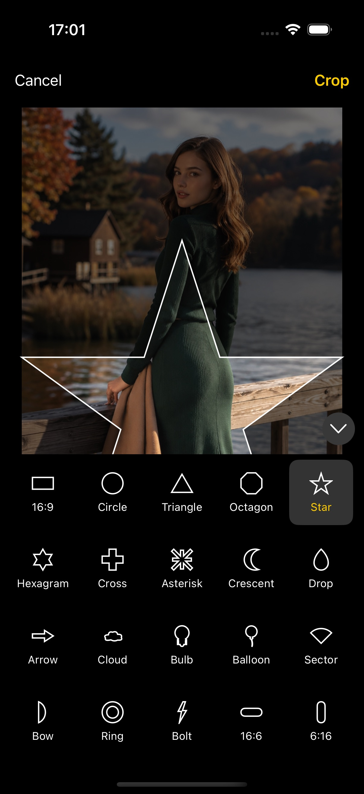
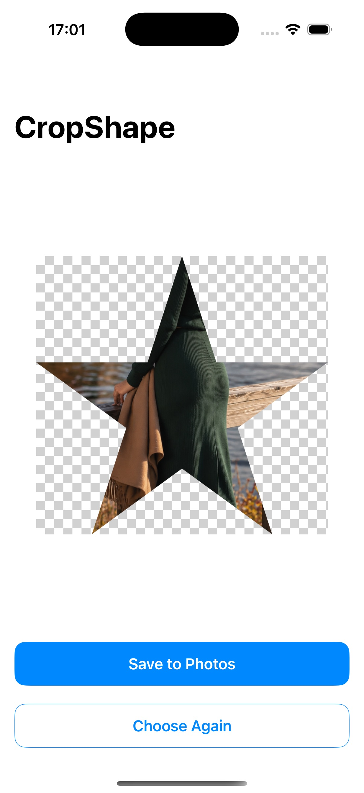

# CropShape

[中文](README.md)

Crop an image to a chosen shape. Pixels outside the shape are transparent. The interface follows the system language: Chinese when the preferred language is Chinese, English otherwise.

<p align="center">
  
  
</p>

Requires iOS 13 or later.

## Installation

```ruby
platform :ios, '13.0'
use_frameworks!

target 'YourApp' do
  pod 'CropShape', '2.0.0'
end
```

Then run:

```bash
pod install --repo-update
```

Open the generated `.xcworkspace`.

## SwiftUI

After the user picks a photo, present the crop screen full screen. One finger pans, two fingers zoom from 1× to 6×, and the image always covers the crop window. Tapping Crop delivers a `UIImage` with an alpha channel to `onCrop`.

```swift
import CropShape
import SwiftUI

struct EditorScreen: View {
    let source: UIImage
    @Binding var isPresented: Bool
    @Binding var cropped: UIImage?

    var body: some View {
        CropShapeEditor(
            image: source,
            kind: .circle,
            onCancel: { isPresented = false },
            onCrop: { image in
                cropped = image
                isPresented = false
            }
        )
        .ignoresSafeArea()
    }
}
```

`kind` is only the shape shown when the screen opens. The user can still switch shapes from the bar.

Save a PNG if the transparent pixels should be kept:

```swift
let data = cropped.pngData()
```

## UIKit

```swift
import CropShape

let editor = CropShapeViewController(image: image, kind: .heart)
editor.onCancel = { editor.dismiss(animated: true) }
editor.onCrop = { image in
    self.croppedImage = image
    editor.dismiss(animated: true)
}
present(editor, animated: true)
```

The controller presents itself full screen.

## Shapes

`CropShapeKind` is `CaseIterable`. `title` is the localized name, `aspectRatio` is width divided by height, and `path(in:)` returns the shape inside a given rectangle.

| Shape | Description |
| --- | --- |
| `heart` | Heart |
| `square` | Square |
| `portrait3x4` / `landscape4x3` | 3:4, 4:3 |
| `portrait9x16` / `landscape16x9` | 9:16, 16:9 |
| `circle` | Circle |
| `equilateralTriangle` | Equilateral triangle |
| `octagon` | Octagon |
| `fivePointStar` / `sixPointStar` | Five-pointed star, hexagram |
| `cross` / `miCharacter` | Cross, asterisk |
| `crescent` / `drop` / `arrow` / `cloud` | Crescent, drop, arrow, cloud |
| `bulb` / `balloon` | Light bulb, balloon |
| `sector` / `segment` / `ring` | Sector, bow, ring |
| `lightning` | Lightning bolt |
| `landscapeCapsule16x6` / `portraitCapsule6x16` | Horizontal 16:6 and vertical 6:16 capsules |

Rectangular shapes show a rule-of-thirds grid. The hole in the ring is transparent too.

## Demo

`Demo/CropShapeDemo` links this repository as a local pod:

```ruby
pod 'CropShape', :path => '../..'
```

Open `Demo/CropShapeDemo/CropShapeDemo.xcworkspace`. Rebuild after editing `Sources` or `Resources`. Run `pod install` again when a new Swift file is added.

## License

MIT
